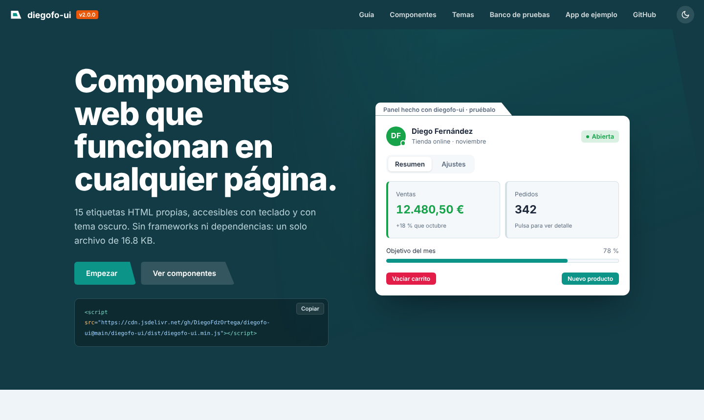
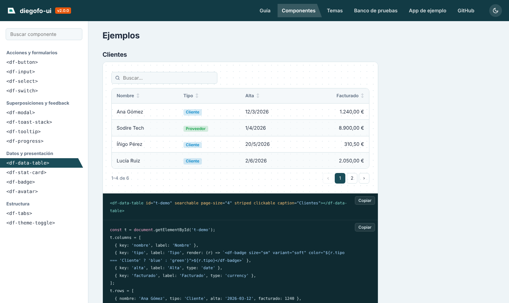
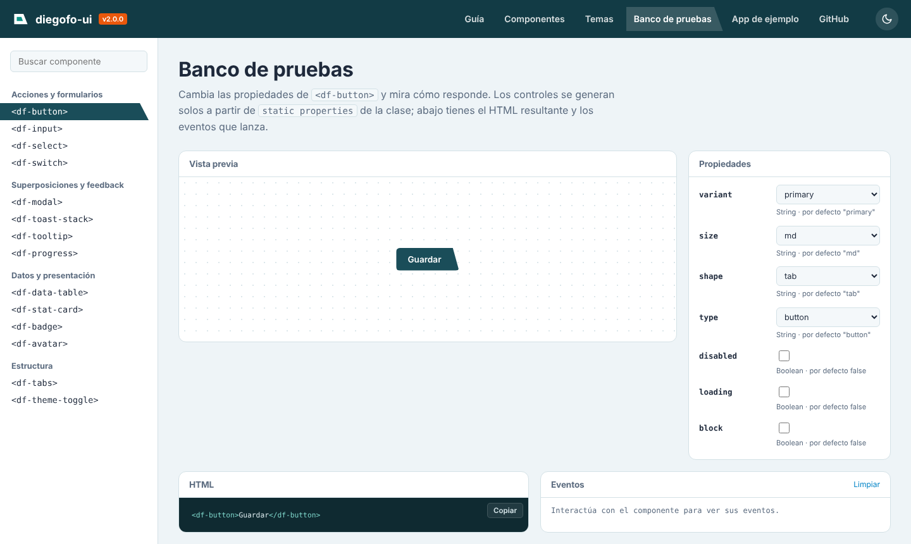
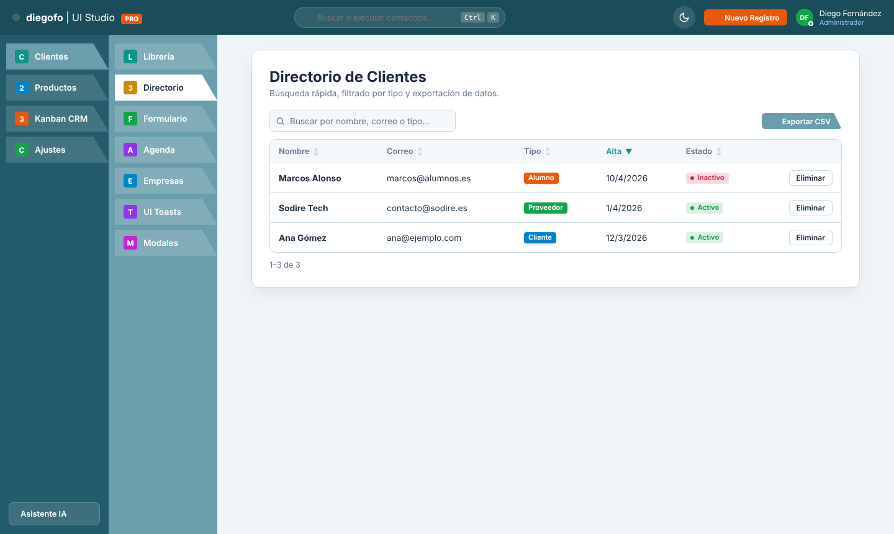

<div align="center">

# diegofo-ui

**Componentes web accesibles y sin dependencias, en JavaScript puro.**

15 etiquetas HTML propias —botones, formularios, modales, tablas de datos, pestañas…— que funcionan en cualquier página, con tema oscuro y manejo completo con teclado.

[](https://github.com/DiegoFdzOrtega/diegofo-ui/actions/workflows/ci.yml)


[](LICENSE)

[**Documentación y demo**](https://diegofdzortega.github.io/diegofo-ui/) · [App de ejemplo](https://diegofdzortega.github.io/diegofo-ui/app/) · [Referencia de la API](diegofo-ui/docs/COMPONENTES.md)



</div>

## Qué es

Una librería de componentes visuales hecha con los estándares del navegador (Custom Elements y Shadow DOM), sin frameworks. Se carga con un `<script>` y se usa como cualquier etiqueta HTML:

```html
<script src="https://cdn.jsdelivr.net/gh/DiegoFdzOrtega/diegofo-ui@main/diegofo-ui/dist/diegofo-ui.min.js"></script>

<df-select label="Tipo de perfil">
  <option value="cliente">Cliente</option>
  <option value="proveedor">Proveedor</option>
</df-select>
<df-button id="guardar" variant="success">Guardar</df-button>

<script>
  const { DfModal, DfToastStack } = window.DiegofoUI;
  document.getElementById('guardar').addEventListener('df-click', async () => {
    if (await DfModal.confirm({ message: '¿Guardar los cambios?' })) {
      DfToastStack.notify('Cambios guardados', 'success');
    }
  });
</script>
```

## Componentes

| Acciones y formularios | Superposiciones y feedback | Datos y presentación | Estructura |
|---|---|---|---|
| `<df-button>` | `<df-modal>` | `<df-data-table>` | `<df-tabs>` + `<df-tab-panel>` |
| `<df-input>` | `<df-toast-stack>` | `<df-stat-card>` | `<df-theme-toggle>` |
| `<df-select>` | `<df-tooltip>` | `<df-badge>` | |
| `<df-switch>` | `<df-progress>` | `<df-avatar>` | |

Cada uno tiene su página en la [documentación](https://diegofdzortega.github.io/diegofo-ui/) con ejemplos en vivo, la tabla de propiedades, eventos y métodos, y notas de accesibilidad.

<table>
<tr>
<td width="50%"></td>
<td width="50%"></td>
</tr>
<tr>
<td>Página de componente: ejemplos ejecutables y código listo para copiar.</td>
<td>Banco de pruebas: los controles se generan leyendo las propiedades de cada clase.</td>
</tr>
</table>

## Puntos destacados

- **Sin dependencias, 16,8 KB con gzip.** Funciona en HTML plano, en React o Vue, o en una app de escritorio con WebView.
- **Accesible.** Roles y estados ARIA, foco visible, foco atrapado en los modales (y devuelto al cerrar), navegación con flechas en pestañas y desplegables, búsqueda por letra en el select, `prefers-reduced-motion`.
- **Formularios de verdad.** `df-input`, `df-select` y `df-switch` son *form-associated custom elements*: participan en un `<form>` nativo, se validan y se resetean.
- **Atajos con promesas.** `DfModal.confirm()` y `DfModal.prompt()` sustituyen a `confirm()` y `prompt()` del navegador, con validación de campos.
- **Temas por variables CSS.** El modo oscuro funciona solo; las piezas internas se pueden retocar con `::part()`.
- **TypeScript.** Tipos generados con autocompletado de etiquetas, propiedades (con sus valores permitidos) y el `detail` de cada evento.
- **154 pruebas automáticas** con Vitest + jsdom, ejecutadas en cada push con GitHub Actions.

## Cómo está construida

```
diegofo-ui/  (raíz del repositorio)
├── diegofo-ui/                 la librería
│   ├── src/core/df-element.js  clase base común
│   ├── src/components/         un archivo por componente
│   ├── test/                   un archivo de pruebas por componente
│   ├── docs/                   web de documentación (SPA sin dependencias)
│   │   └── assets/componentes.js   fuente única de la documentación
│   ├── scripts/build.mjs       empaquetado con esbuild
│   ├── scripts/docs.mjs        genera COMPONENTES.md y los tipos .d.ts
│   ├── dist/                   librería empaquetada (ESM + script minificado)
│   └── types/                  tipos de TypeScript
├── app/                        aplicación de ejemplo que usa la librería
└── .github/workflows/          CI y despliegue en GitHub Pages
```

Algunas decisiones técnicas:

- **Una clase base con propiedades declarativas.** Cada componente declara `static properties = { variant: { type: String, default: 'primary' } }` y `DfElement` genera los getters/setters, los sincroniza con los atributos HTML y vuelve a pintar solo cuando algo cambia. Así cada componente se centra en su plantilla y su comportamiento.
- **Una sola fuente para la documentación.** La web, la referencia en Markdown y los tipos de TypeScript salen del mismo archivo de datos más las propias clases, así que no pueden desincronizarse. Los tipos y los valores por defecto de las tablas se leen del código.
- **Eventos con prefijo `df-`** que burbujean y atraviesan el Shadow DOM (`composed: true`), con los datos en `event.detail`. Los cambios hechos por código no lanzan eventos; solo la interacción del usuario.
- **Funciones puras separadas** (`validateValue`, `formatValue`, `queryRows`, `initials`) para poder probar la lógica sin DOM.

## Desarrollo

Necesitas Node.js 18 o superior.

```bash
cd diegofo-ui
npm install        # herramientas de desarrollo
npm test           # pruebas
npm run coverage   # pruebas + informe de cobertura
npm run build      # dist/, tipos, referencia y copia a ../app/lib
npm run dev        # sirve el proyecto en http://localhost:5173
```

La web de documentación (`diegofo-ui/docs/index.html`) y la app (`app/index.html`) también se abren directamente con doble clic.

### Publicar la web

El workflow `.github/workflows/pages.yml` pasa las pruebas, empaqueta y publica la documentación, la librería y la app en GitHub Pages en cada push a `main`. Solo hay que activar **Settings → Pages → Source: GitHub Actions**.

## App de ejemplo

`app/` es una estación de trabajo (CRM, inventario, Kanban, agenda y asistente de IA local con Ollama) construida con la librería: tablas con búsqueda y orden, formularios validados, modales en lugar de `prompt()`, métricas, tooltips y tema oscuro.




## Autor

**Diego Fernández Ortega** · [GitHub](https://github.com/DiegoFdzOrtega)

Licencia [MIT](LICENSE).
